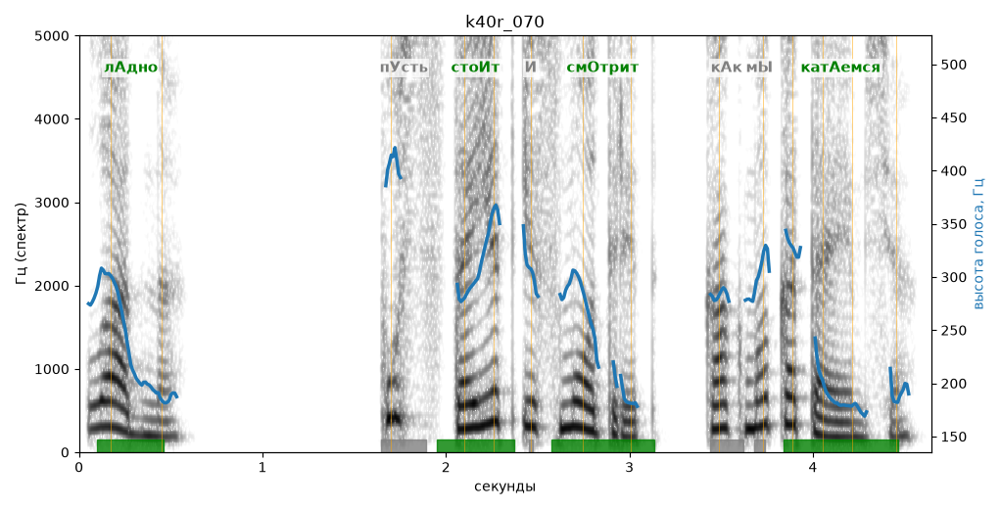

# k40r_070

Эталон: Ладно. Пусть стоит и смотрит, как мы катаемся.
Распознано: Ладно. Пусть стоит и смотрит, как мы катаемся.
Слова: все совпали

## Ударения
(где нужно: ruaccent)

| слово | нужно | у голоса | |
|---|---|---|---|
| ладно | лАдно | лАдно | ✓ |
| стоит | стоИт | стоИт | ✓ |
| смотрит | смОтрит | смОтрит | ✓ |
| катаемся | катАемся | катАемся | ✓ |

## Интонация
- ✓ «пусть стоит и смотрит как мы катаемся.» — конец фразы понижается — звучит законченно
- Диапазон голоса 12.3 полутонов (живо), средняя высота 278 Гц

## Паузы и темп
- паузы на своих местах
- Темп 4.9 слога/с (нормально)

_Синяя линия — высота голоса. Над словами заглавная буква — где ударение должно быть; красным — голос поставил не туда (уверенно), оранжевым — возможно._
