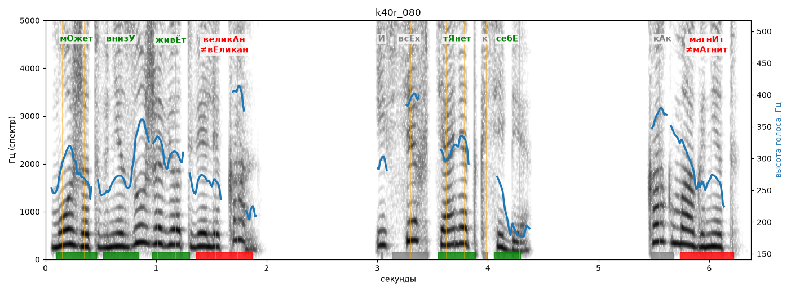

# k40r_080

Эталон: Может, внизу живёт великан? И всех тянет к себе. Как магнит!
Распознано: Может, внизу живет великан? И всех тянет к себе. Как магнит?
Слова: все совпали

## Ударения
(где нужно: ruaccent)

| слово | нужно | у голоса | |
|---|---|---|---|
| может | мОжет | мОжет | ✓ |
| внизу | внизУ | внизУ | ✓ |
| живёт | живЁт | живЁт | ✓ |
| великан | великАн | вЕликан | ✗ ОШИБКА |
| тянет | тЯнет | тЯнет | ✓ |
| себе | себЕ | себЕ | ✓ |
| магнит | магнИт | мАгнит | ✗ ОШИБКА |

## Интонация
- ✓ «может внизу живёт великан?» — вопросительный подъём на слове «великан»
- ✓ «и всех тянет к себе.» — конец фразы понижается — звучит законченно
- ✓ «как магнит!» — выделено слово «как» (+3.4 пт)
- Диапазон голоса 12.4 полутонов (живо), средняя высота 280 Гц

## Паузы и темп
- паузы на своих местах
- Темп 5.0 слога/с (нормально)

_Синяя линия — высота голоса. Над словами заглавная буква — где ударение должно быть; красным — голос поставил не туда (уверенно), оранжевым — возможно._
