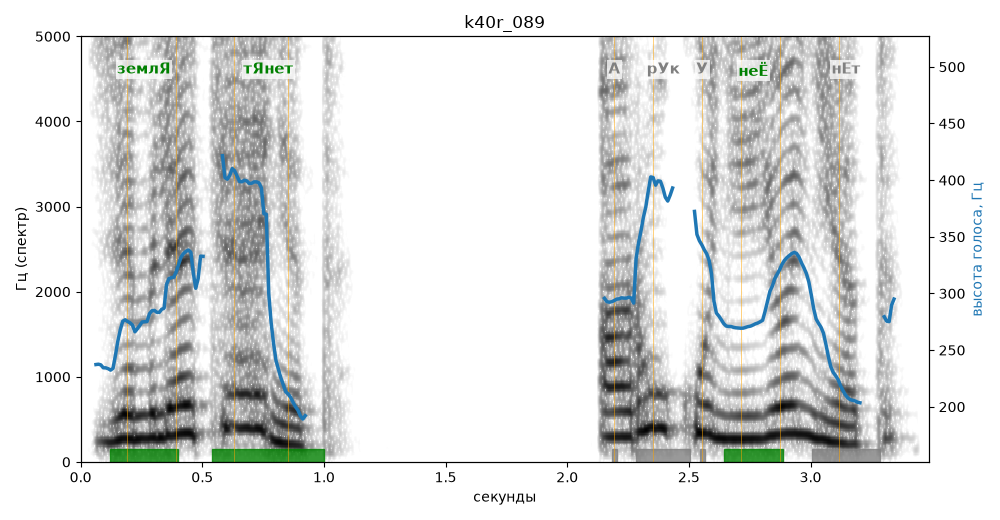

# k40r_089

Эталон: Земля тянет? А рук у неё нет!
Распознано: Земля тянет, а руку не ее нет.
Расхождения в словах: «рук у нее» → «руку не ее»

## Ударения
(где нужно: ruaccent)

| слово | нужно | у голоса | |
|---|---|---|---|
| земля | землЯ | землЯ | ✓ |
| тянет | тЯнет | тЯнет | ✓ |
| неё | неЁ | неЁ | ✓ |

## Интонация
- ✓ «земля тянет?» — вопросительный подъём на слове «тянет»
- ✓ «а рук у неё нет!» — выделено слово «рук» (+4.0 пт)
- Диапазон голоса 11.5 полутонов (живо), средняя высота 293 Гц

## Паузы и темп
- паузы на своих местах
- Темп 5.0 слога/с (нормально)

_Синяя линия — высота голоса. Над словами заглавная буква — где ударение должно быть; красным — голос поставил не туда (уверенно), оранжевым — возможно._
