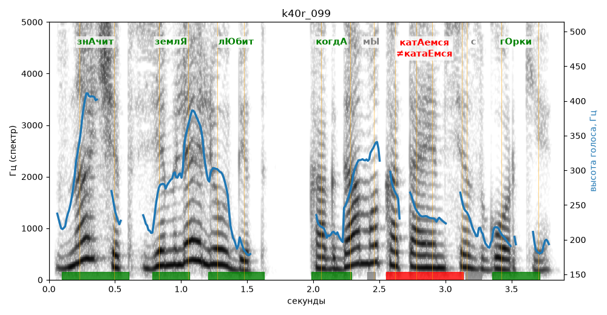

# k40r_099

Эталон: Значит, Земля любит, когда мы катаемся с горки!
Распознано: Значит, земля любит, когда мы катаемся с горки.
Слова: все совпали

## Ударения
(где нужно: ruaccent)

| слово | нужно | у голоса | |
|---|---|---|---|
| значит | знАчит | знАчит | ✓ |
| земля | землЯ | землЯ | ✓ |
| любит | лЮбит | лЮбит | ✓ |
| когда | когдА | когдА | ✓ |
| катаемся | катАемся | катаЕмся | ✗ ОШИБКА |
| горки | гОрки | гОрки | ✓ |

## Интонация
- ✓ «значит земля любит когда мы катаемся с горки!» — выделено слово «значит» (+6.9 пт)
- Диапазон голоса 12.3 полутонов (живо), средняя высота 239 Гц

## Паузы и темп
- паузы на своих местах
- Темп 5.2 слога/с (нормально)

_Синяя линия — высота голоса. Над словами заглавная буква — где ударение должно быть; красным — голос поставил не туда (уверенно), оранжевым — возможно._
