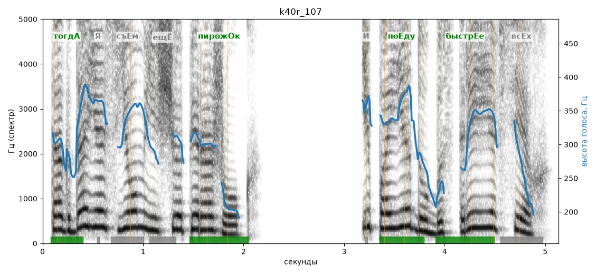

# k40r_107

Эталон: Тогда я съем ещё пирожок. И поеду быстрее всех!
Распознано: Тогда я съем еще пирожок. И поеду быстрее всех.
Слова: все совпали

## Ударения
(где нужно: ruaccent)

| слово | нужно | у голоса | |
|---|---|---|---|
| тогда | тогдА | тогдА | ✓ |
| ещё | ещЁ | Ещё | ? не разобрать |
| пирожок | пирожОк | пирожОк | ✓ |
| поеду | поЕду | поЕду | ✓ |
| быстрее | быстрЕе | быстрЕе | ✓ |

## Интонация
- ✓ «тогда я съем ещё пирожок.» — конец фразы понижается — звучит законченно
- ✗ «и поеду быстрее всех!» — восклицание звучит ровно, без эмоции
- Диапазон голоса 10.1 полутонов (живо), средняя высота 312 Гц

## Паузы и темп
- паузы на своих местах
- Темп 4.3 слога/с (нормально)

_Синяя линия — высота голоса. Над словами заглавная буква — где ударение должно быть; красным — голос поставил не туда (уверенно), оранжевым — возможно._
