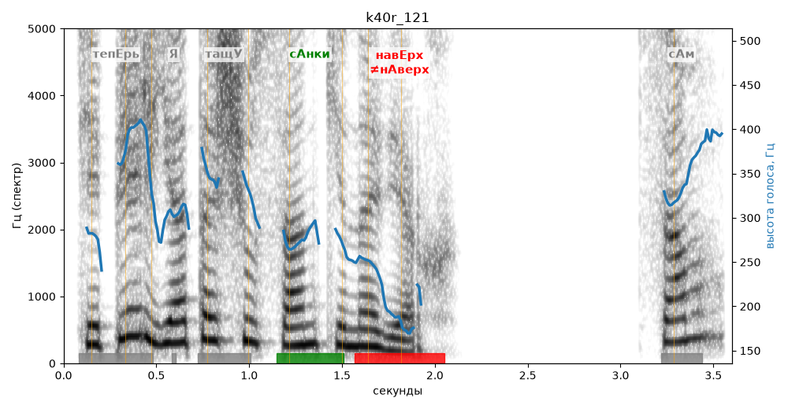

# k40r_121

Эталон: Теперь я тащу санки наверх. Сам!
Распознано: Теперь я тащу санки наверх. Сам...
Слова: все совпали

## Ударения
(где нужно: ruaccent)

| слово | нужно | у голоса | |
|---|---|---|---|
| теперь | тепЕрь | — | ? |
| тащу | тащУ | тАщу | ? не разобрать |
| санки | сАнки | сАнки | ✓ |
| наверх | навЕрх | нАверх | ✗ ОШИБКА |

## Интонация
- ✓ «теперь я тащу санки наверх.» — конец фразы понижается — звучит законченно
- Диапазон голоса 13.1 полутонов (живо), средняя высота 297 Гц

## Паузы и темп
- паузы на своих местах
- Темп 4.6 слога/с (нормально)

_Синяя линия — высота голоса. Над словами заглавная буква — где ударение должно быть; красным — голос поставил не туда (уверенно), оранжевым — возможно._
