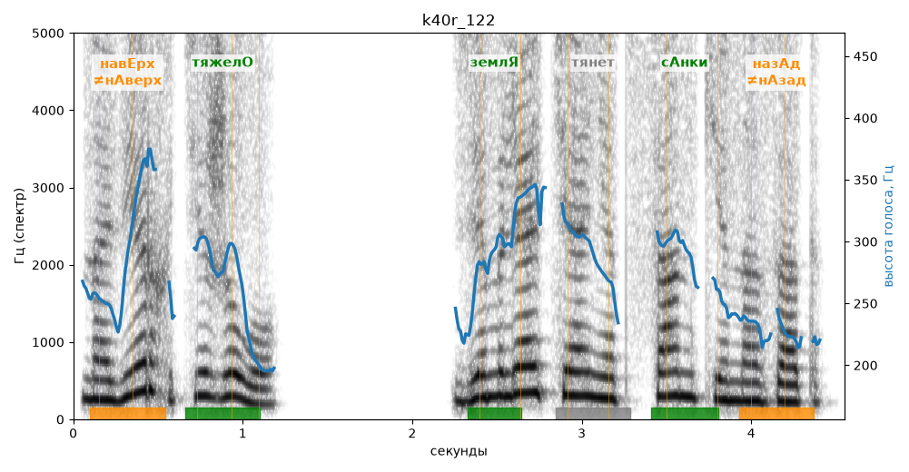

# k40r_122

Эталон: Наверх тяжело. Земля тянет санки назад!
Распознано: На верх тяжело. Земля тянет санки назад.
Расхождения в словах: «наверх» → «на верх»

## Ударения
(где нужно: ruaccent)

| слово | нужно | у голоса | |
|---|---|---|---|
| наверх | навЕрх | нАверх | ✗? возможно — послушать |
| тяжело | тяжелО | тяжелО | ✓ |
| земля | землЯ | землЯ | ✓ |
| тянет | тянет | тЯнет | нет эталона |
| санки | сАнки | сАнки | ✓ |
| назад | назАд | нАзад | ✗? возможно — послушать |

## Интонация
- ✓ «наверх тяжело.» — конец фразы понижается — звучит законченно
- ✓ «земля тянет санки назад!» — выделено слово «земля» (+3.2 пт)
- Диапазон голоса 8.5 полутонов (живо), средняя высота 274 Гц

## Паузы и темп
- паузы на своих местах
- Темп 4.6 слога/с (нормально)

_Синяя линия — высота голоса. Над словами заглавная буква — где ударение должно быть; красным — голос поставил не туда (уверенно), оранжевым — возможно._
