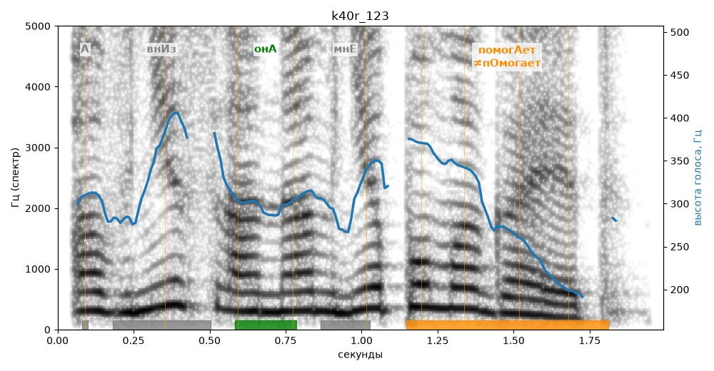

# k40r_123

Эталон: А вниз она мне помогает!
Распознано: А вниз она мне помогает.
Слова: все совпали

## Ударения
(где нужно: ruaccent)

| слово | нужно | у голоса | |
|---|---|---|---|
| она | онА | онА | ✓ |
| помогает | помогАет | пОмогает | ✗? возможно — послушать |

## Интонация
- ✓ «а вниз она мне помогает!» — выделено слово «вниз» (+3.2 пт)
- Диапазон голоса 10.5 полутонов (живо), средняя высота 304 Гц

## Паузы и темп
- паузы на своих местах
- Темп 5.2 слога/с (нормально)

_Синяя линия — высота голоса. Над словами заглавная буква — где ударение должно быть; красным — голос поставил не туда (уверенно), оранжевым — возможно._
