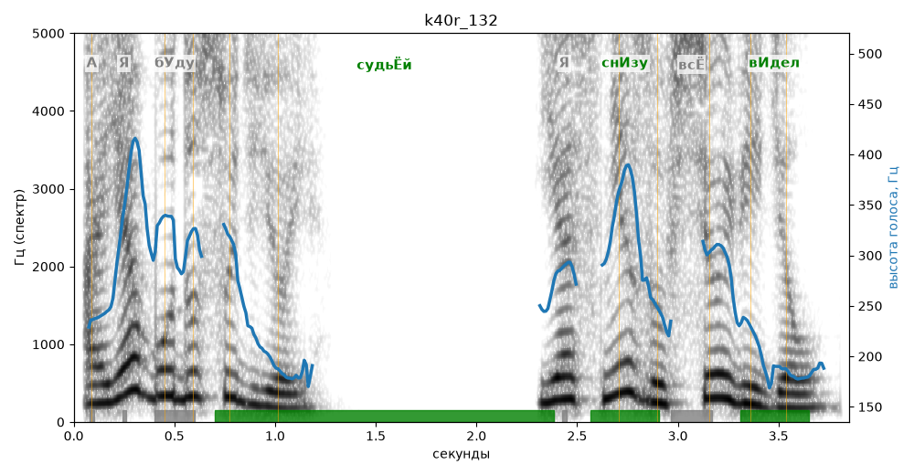

# k40r_132

Эталон: А я буду судьёй. Я снизу всё видел!
Распознано: А я буду судьей. Я снизу все видел.
Слова: все совпали

## Ударения
(где нужно: ruaccent)

| слово | нужно | у голоса | |
|---|---|---|---|
| буду | бУду | будУ | ? не разобрать |
| судьёй | судьЁй | судьЁй | ✓ |
| снизу | снИзу | снИзу | ✓ |
| видел | вИдел | вИдел | ✓ |

## Интонация
- ✓ «а я буду судьёй.» — конец фразы понижается — звучит законченно
- ✓ «я снизу всё видел!» — выделено слово «снизу» (+6.0 пт)
- Диапазон голоса 13.0 полутонов (живо), средняя высота 257 Гц

## Паузы и темп
- после «судьёй.» пауза всего 0.04 с — фразы слипаются
- Темп 2.8 слога/с (медленно)

_Синяя линия — высота голоса. Над словами заглавная буква — где ударение должно быть; красным — голос поставил не туда (уверенно), оранжевым — возможно._
