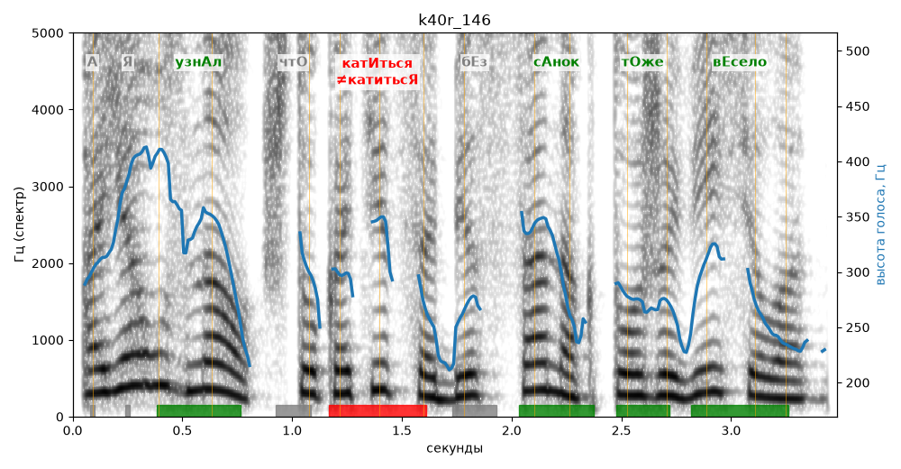

# k40r_146

Эталон: А я узнал, что катиться без санок тоже весело!
Распознано: А я узнал, что катится без сана, кто же весело.
Расхождения в словах: «катиться» → «катится»; «санок тоже» → «сана кто же»

## Ударения
(где нужно: ruaccent)

| слово | нужно | у голоса | |
|---|---|---|---|
| узнал | узнАл | узнАл | ✓ |
| катиться | катИться | катитьсЯ | ✗ ОШИБКА |
| санок | сАнок | сАнок | ✓ |
| тоже | тОже | тОже | ✓ |
| весело | вЕсело | вЕсело | ✓ |

## Интонация
- ✓ «а я узнал что катиться без санок тоже весело!» — выделено слово «катиться» (+2.6 пт)
- Диапазон голоса 9.9 полутонов (живо), средняя высота 294 Гц

## Паузы и темп
- паузы на своих местах
- Темп 5.0 слога/с (нормально)

_Синяя линия — высота голоса. Над словами заглавная буква — где ударение должно быть; красным — голос поставил не туда (уверенно), оранжевым — возможно._
