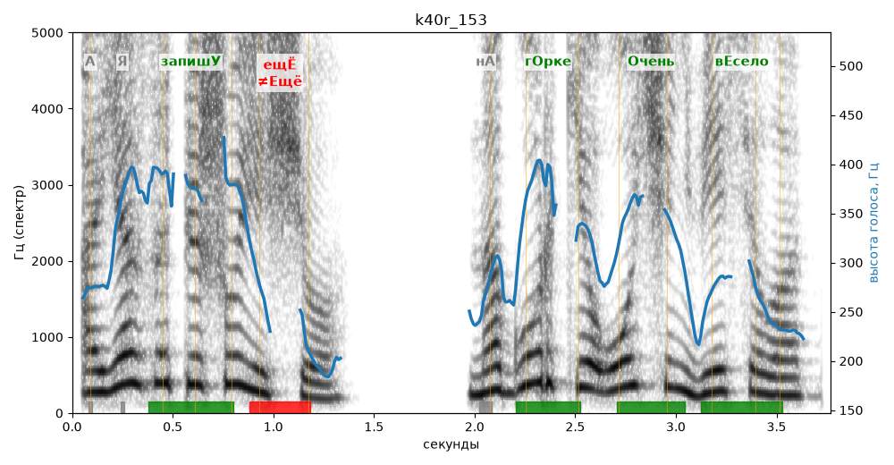

# k40r_153

Эталон: А я запишу ещё: на горке очень весело!
Распознано: А я запишу еще. На горке очень весело.
Слова: все совпали

## Ударения
(где нужно: ruaccent)

| слово | нужно | у голоса | |
|---|---|---|---|
| запишу | запишУ | запишУ | ✓ |
| ещё | ещЁ | Ещё | ✗ ОШИБКА |
| горке | гОрке | гОрке | ✓ |
| очень | Очень | Очень | ✓ |
| весело | вЕсело | вЕсело | ✓ |

## Интонация
- ✓ «а я запишу ещё на горке очень весело!» — выделено слово «запишу» (+3.9 пт)
- Диапазон голоса 11.5 полутонов (живо), средняя высота 292 Гц

## Паузы и темп
- паузы на своих местах
- Темп 5.8 слога/с (нормально)

_Синяя линия — высота голоса. Над словами заглавная буква — где ударение должно быть; красным — голос поставил не туда (уверенно), оранжевым — возможно._
