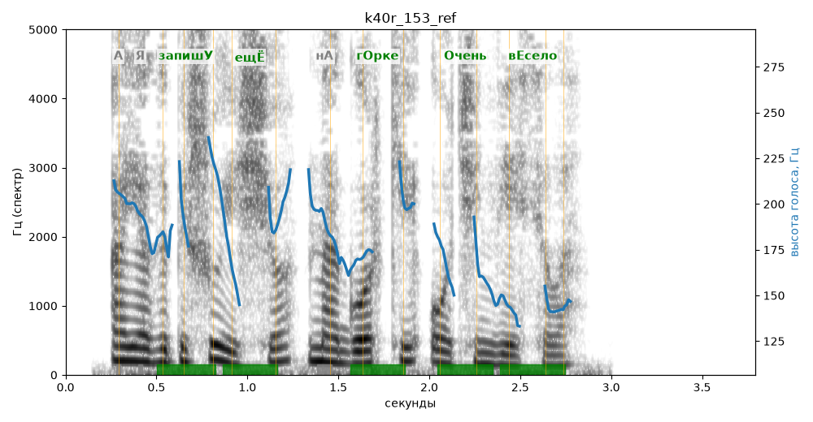

# k40r_153_ref

Голос: **edge:ru-RU-SvetlanaNeural** · длительность 3.8 с
Эталон: А я запишу ещё: на горке очень весело!
Распознано: А я запишу еще на горке очень весело.
Слова: все совпали

## Ударения
(где нужно: ruaccent)

| слово | нужно | у голоса | |
|---|---|---|---|
| запишу | запишУ | запишУ | ✓ |
| ещё | ещЁ | ещЁ | ✓ |
| горке | гОрке | гОрке | ✓ |
| очень | Очень | Очень | ✓ |
| весело | вЕсело | вЕсело | ✓ |

## Интонация
- ✓ «а я запишу ещё на горке очень весело!» — выделено слово «запишу» (+3.7 пт)
- Диапазон голоса 7.4 полутонов (живо), средняя высота 180 Гц

## Паузы и темп
- паузы на своих местах
- Темп 6.8 слога/с (быстро)

_Синяя линия — высота голоса. Над словами заглавная буква — где ударение должно быть; красным — голос поставил не туда (уверенно), оранжевым — возможно._
