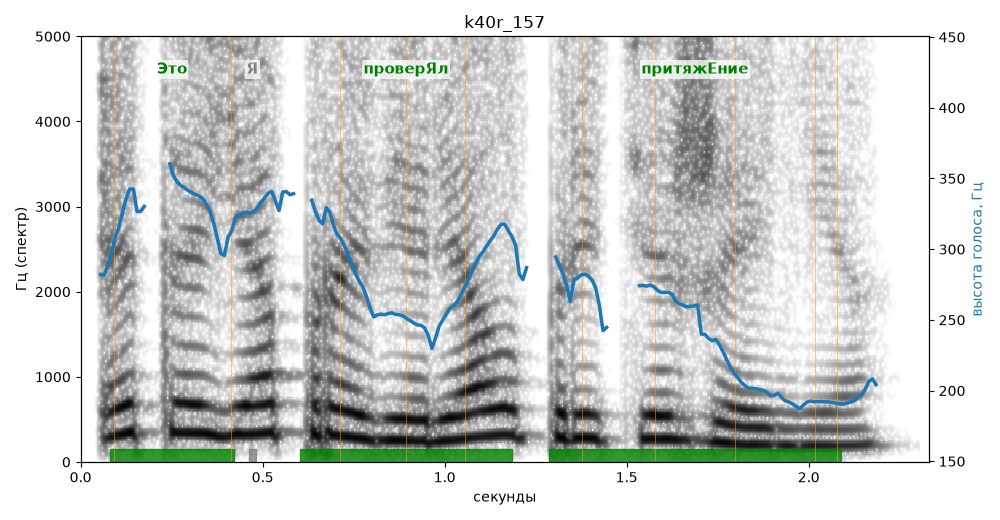

# k40r_157

Эталон: Это я проверял притяжение.
Распознано: Это я проверял протяжение.
Расхождения в словах: «притяжение» → «протяжение»

## Ударения
(где нужно: ruaccent)

| слово | нужно | у голоса | |
|---|---|---|---|
| это | Это | Это | ✓ |
| проверял | проверЯл | проверЯл | ✓ |
| притяжение | притяжЕние | притяжЕние | ✓ |

## Интонация
- ✓ «это я проверял притяжение.» — конец фразы понижается — звучит законченно
- Диапазон голоса 9.9 полутонов (живо), средняя высота 273 Гц

## Паузы и темп
- паузы на своих местах
- Темп 5.0 слога/с (нормально)

_Синяя линия — высота голоса. Над словами заглавная буква — где ударение должно быть; красным — голос поставил не туда (уверенно), оранжевым — возможно._
