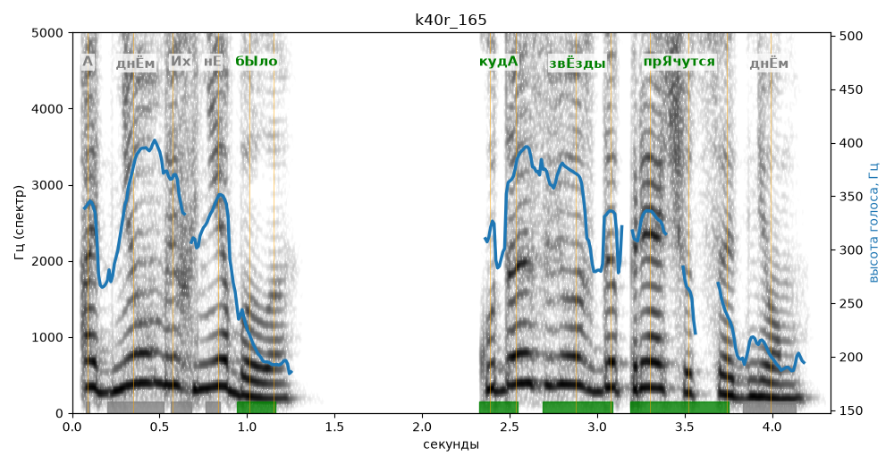

# k40r_165

Эталон: А днём их не было. Куда звёзды прячутся днём?
Распознано: Однём их не было. Куда звёзда прячутся днём?
Расхождения в словах: «а днем» → «однем»; «звезды» → «звезда»

## Ударения
(где нужно: ruaccent)

| слово | нужно | у голоса | |
|---|---|---|---|
| было | бЫло | бЫло | ✓ |
| куда | кудА | кудА | ✓ |
| звёзды | звЁзды | звЁзды | ✓ |
| прячутся | прЯчутся | прЯчутся | ✓ |

## Интонация
- ✓ «а днём их не было.» — конец фразы понижается — звучит законченно
- ✓ «куда звёзды прячутся днём?» — конец фразы понижается — звучит законченно
- Диапазон голоса 12.4 полутонов (живо), средняя высота 312 Гц

## Паузы и темп
- паузы на своих местах
- Темп 4.8 слога/с (нормально)

_Синяя линия — высота голоса. Над словами заглавная буква — где ударение должно быть; красным — голос поставил не туда (уверенно), оранжевым — возможно._
