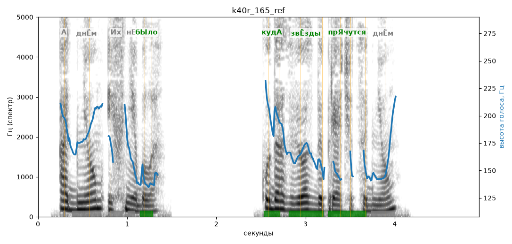

# k40r_165_ref

Голос: **edge:ru-RU-SvetlanaNeural** · длительность 4.9 с
Эталон: А днём их не было. Куда звёзды прячутся днём?
Распознано: Однём их не было. Куда звёзды прячется днём?
Расхождения в словах: «а днем» → «однем»; «прячутся» → «прячется»

## Ударения
(где нужно: ruaccent)

| слово | нужно | у голоса | |
|---|---|---|---|
| было | бЫло | бЫло | ✓ |
| куда | кудА | кудА | ✓ |
| звёзды | звЁзды | звЁзды | ✓ |
| прячутся | прЯчутся | прЯчутся | ✓ |

## Интонация
- ✓ «а днём их не было.» — конец фразы понижается — звучит законченно
- ✓ «куда звёзды прячутся днём?» — конец фразы понижается — звучит законченно
- Диапазон голоса 7.2 полутонов (живо), средняя высота 166 Гц

## Паузы и темп
- паузы на своих местах
- Темп 5.7 слога/с (нормально)

_Синяя линия — высота голоса. Над словами заглавная буква — где ударение должно быть; красным — голос поставил не туда (уверенно), оранжевым — возможно._
