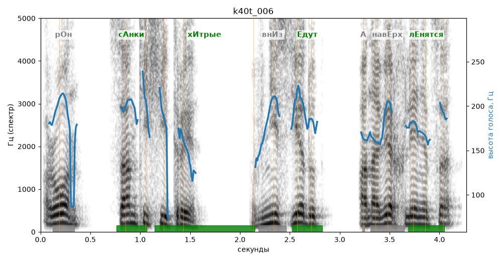

# k40t_006

Эталон: Рон, санки хитрые. Вниз едут, а наверх ленятся!
Распознано: Рон, санки хитры. Вниз едут, а наверх лениться.
Расхождения в словах: «хитрые» → «хитры»; «ленятся» → «лениться»

## Ударения
(где нужно: ruaccent)

| слово | нужно | у голоса | |
|---|---|---|---|
| санки | сАнки | сАнки | ✓ |
| хитрые | хИтрые | хИтрые | ✓ |
| едут | Едут | Едут | ✓ |
| наверх | навЕрх | нАверх | ? не разобрать |
| ленятся | лЕнятся | лЕнятся | ✓ |

## Интонация
- ✗ «рон санки хитрые.» — конец фразы не понижается — звучит незаконченно / как перечисление
- ✓ «вниз едут а наверх ленятся!» — выделено слово «едут» (+2.2 пт)
- Диапазон голоса 8.9 полутонов (живо), средняя высота 182 Гц

## Паузы и темп
- после «хитрые.» пауза всего 0.04 с — фразы слипаются
- Темп 4.8 слога/с (нормально)

_Синяя линия — высота голоса. Над словами заглавная буква — где ударение должно быть; красным — голос поставил не туда (уверенно), оранжевым — возможно._
