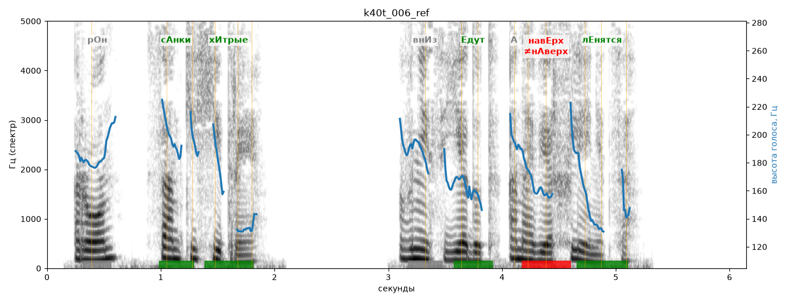

# k40t_006_ref

Голос: **edge:ru-RU-SvetlanaNeural** · длительность 6.1 с
Эталон: Рон, санки хитрые. Вниз едут, а наверх ленятся!
Распознано: Рон, самки хитрые. Внес едут она верх леница.
Расхождения в словах: «санки» → «самки»; «вниз» → «внес»; «а наверх ленятся» → «она верх леница»

## Ударения
(где нужно: ruaccent)

| слово | нужно | у голоса | |
|---|---|---|---|
| санки | сАнки | сАнки | ✓ |
| хитрые | хИтрые | хИтрые | ✓ |
| едут | Едут | Едут | ✓ |
| наверх | навЕрх | нАверх | ✗ ОШИБКА |
| ленятся | лЕнятся | лЕнятся | ✓ |

## Интонация
- ✗ «рон санки хитрые.» — конец фразы не понижается — звучит незаконченно / как перечисление
- ✓ «вниз едут а наверх ленятся!» — выделено слово «а» (+2.6 пт)
- Диапазон голоса 7.8 полутонов (живо), средняя высота 177 Гц

## Паузы и темп
- паузы на своих местах
- Темп 5.3 слога/с (нормально)

_Синяя линия — высота голоса. Над словами заглавная буква — где ударение должно быть; красным — голос поставил не туда (уверенно), оранжевым — возможно._
