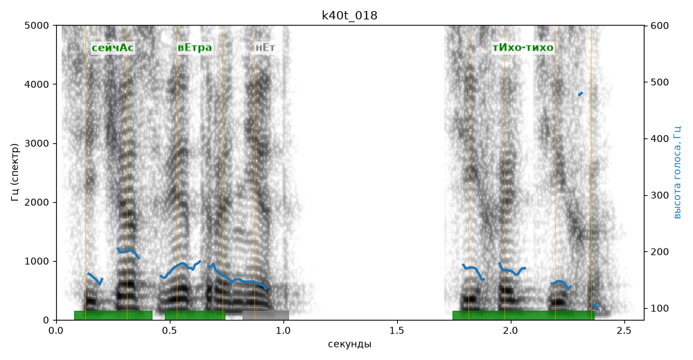

# k40t_018

Эталон: Сейчас ветра нет. Тихо-тихо.
Распознано: Сейчас ветра нет. Тихо-тихо.
Слова: все совпали

## Ударения
(где нужно: ruaccent)

| слово | нужно | у голоса | |
|---|---|---|---|
| сейчас | сейчАс | сейчАс | ✓ |
| ветра | вЕтра | вЕтра | ✓ |
| тихо-тихо | тИхо-тихо | тИхо-тихо | ✓ |

## Интонация
- ✓ «сейчас ветра нет.» — конец фразы понижается — звучит законченно
- ✗ «тихо-тихо.» — конец фразы не понижается — звучит незаконченно / как перечисление
- Диапазон голоса 6.6 полутонов (нормально), средняя высота 161 Гц

## Паузы и темп
- паузы на своих местах
- Темп 5.8 слога/с (нормально)

_Синяя линия — высота голоса. Над словами заглавная буква — где ударение должно быть; красным — голос поставил не туда (уверенно), оранжевым — возможно._
