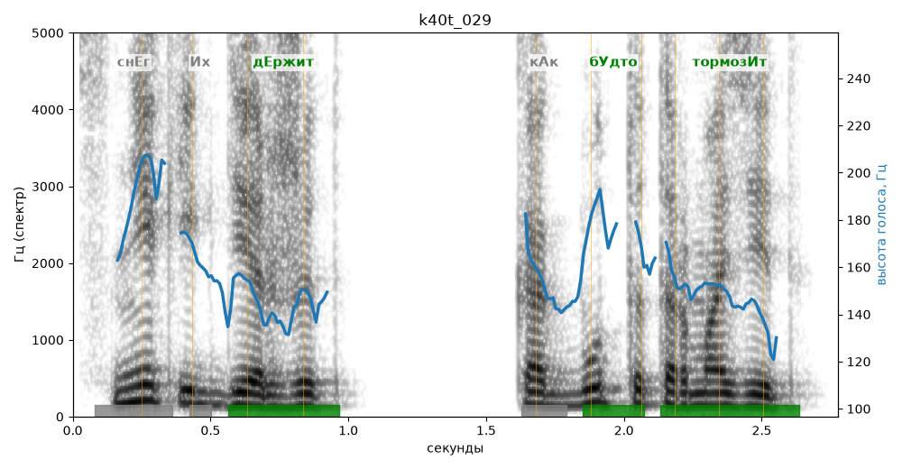

# k40t_029

Эталон: Снег их держит. Как будто тормозит.
Распознано: Снег и гдержит. Как будто тормозит.
Расхождения в словах: «их держит» → «и гдержит»

## Ударения
(где нужно: ruaccent)

| слово | нужно | у голоса | |
|---|---|---|---|
| держит | дЕржит | дЕржит | ✓ |
| будто | бУдто | бУдто | ✓ |
| тормозит | тормозИт | тормозИт | ✓ |

## Интонация
- ✓ «снег их держит.» — конец фразы понижается — звучит законченно
- ✓ «как будто тормозит.» — конец фразы понижается — звучит законченно
- Диапазон голоса 6.6 полутонов (нормально), средняя высота 153 Гц

## Паузы и темп
- паузы на своих местах
- Темп 5.3 слога/с (нормально)

_Синяя линия — высота голоса. Над словами заглавная буква — где ударение должно быть; красным — голос поставил не туда (уверенно), оранжевым — возможно._
