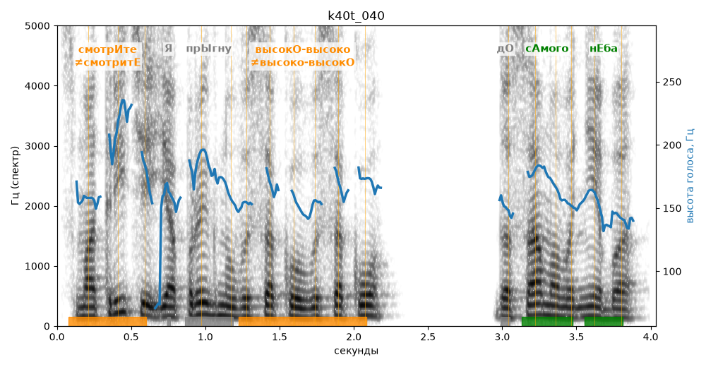

# k40t_040

Эталон: Смотрите! Я прыгну высоко-высоко. До самого неба!
Распознано: Смотрите, я прыгну высоко-высоко до самого неба.
Слова: все совпали

## Ударения
(где нужно: ruaccent)

| слово | нужно | у голоса | |
|---|---|---|---|
| смотрите | смотрИте | смотритЕ | ✗? возможно — послушать |
| прыгну | прЫгну | прыгнУ | ? не разобрать |
| высоко-высоко | высокО-высоко | высоко-высокО | ✗? возможно — послушать |
| самого | сАмого | сАмого | ✓ |
| неба | нЕба | нЕба | ✓ |

## Интонация
- ✓ «смотрите!» — выделено слово «смотрите» (+5.3 пт)
- ✓ «я прыгну высоко-высоко.» — конец фразы понижается — звучит законченно
- ✓ «до самого неба!» — выделено слово «самого» (+2.7 пт)
- Диапазон голоса 7.0 полутонов (живо), средняя высота 160 Гц

## Паузы и темп
- после «смотрите!» пауза всего 0.14 с — фразы слипаются
- Темп 6.0 слога/с (нормально)

_Синяя линия — высота голоса. Над словами заглавная буква — где ударение должно быть; красным — голос поставил не туда (уверенно), оранжевым — возможно._
