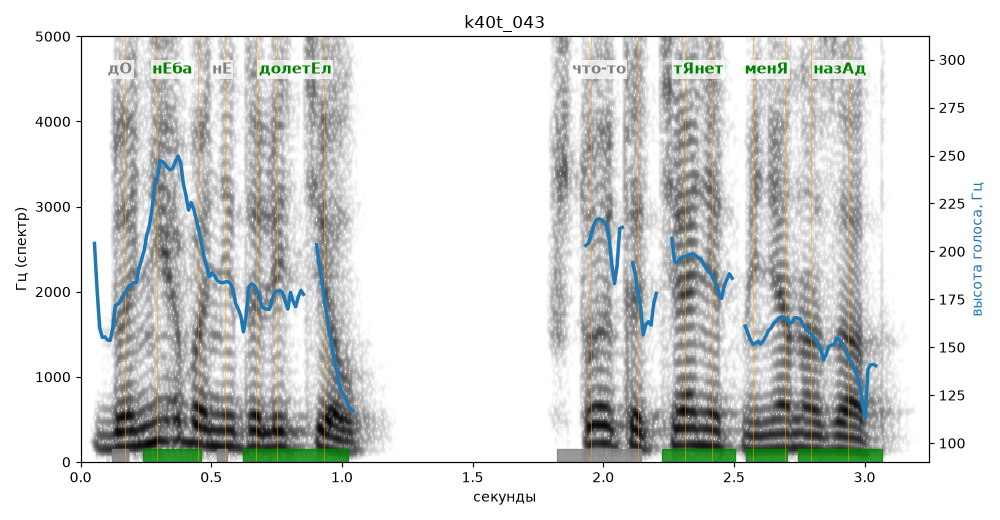

# k40t_043

Эталон: До неба не долетел. Что-то тянет меня назад.
Распознано: до неба не долетел. Что это тянет меня назад?
Расхождения в словах: «что-то» → «что это»

## Ударения
(где нужно: ruaccent)

| слово | нужно | у голоса | |
|---|---|---|---|
| неба | нЕба | нЕба | ✓ |
| долетел | долетЕл | долетЕл | ✓ |
| что-то | что-то | чтО-то | нет эталона |
| тянет | тЯнет | тЯнет | ✓ |
| меня | менЯ | менЯ | ✓ |
| назад | назАд | назАд | ✓ |

## Интонация
- ✓ «до неба не долетел.» — конец фразы понижается — звучит законченно
- ✓ «что-то тянет меня назад.» — конец фразы понижается — звучит законченно
- Диапазон голоса 9.5 полутонов (живо), средняя высота 178 Гц

## Паузы и темп
- паузы на своих местах
- Темп 7.0 слога/с (быстро)

_Синяя линия — высота голоса. Над словами заглавная буква — где ударение должно быть; красным — голос поставил не туда (уверенно), оранжевым — возможно._
