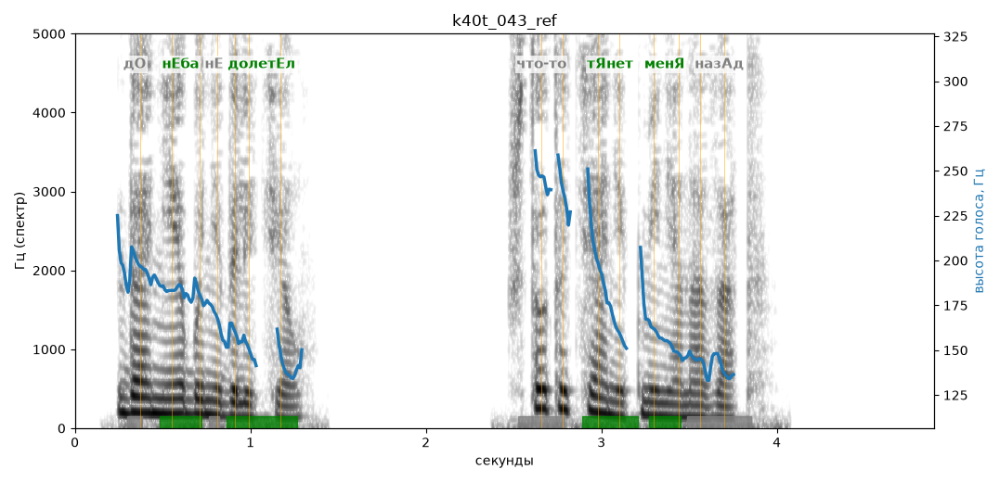

# k40t_043_ref

Голос: **edge:ru-RU-SvetlanaNeural** · длительность 4.9 с
Эталон: До неба не долетел. Что-то тянет меня назад.
Распознано: Данее бы не долетел. Что-то тянет меня назад.
Расхождения в словах: «до неба» → «данее бы»

## Ударения
(где нужно: ruaccent)

| слово | нужно | у голоса | |
|---|---|---|---|
| неба | нЕба | нЕба | ✓ |
| долетел | долетЕл | долетЕл | ✓ |
| что-то | что-то | чтО-то | нет эталона |
| тянет | тЯнет | тЯнет | ✓ |
| меня | менЯ | менЯ | ✓ |
| назад | назАд | нАзад | ? не разобрать |

## Интонация
- ✓ «до неба не долетел.» — конец фразы понижается — звучит законченно
- ✓ «что-то тянет меня назад.» — конец фразы понижается — звучит законченно
- Диапазон голоса 10.0 полутонов (живо), средняя высота 167 Гц

## Паузы и темп
- паузы на своих местах
- Темп 6.6 слога/с (быстро)

_Синяя линия — высота голоса. Над словами заглавная буква — где ударение должно быть; красным — голос поставил не туда (уверенно), оранжевым — возможно._
