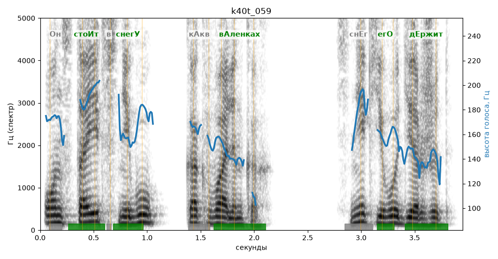

# k40t_059

Эталон: Он стоит в снегу, как в валенках. Снег его держит.
Распознано: Он стоит в снегу, как в валенках. Снег его держит.
Слова: все совпали

## Ударения
(где нужно: ruaccent)

| слово | нужно | у голоса | |
|---|---|---|---|
| стоит | стоИт | стоИт | ✓ |
| снегу | снегУ | снегУ | ✓ |
| валенках | вАленках | вАленках | ✓ |
| его | егО | егО | ✓ |
| держит | дЕржит | дЕржит | ✓ |

## Интонация
- ✓ «он стоит в снегу как в валенках.» — конец фразы понижается — звучит законченно
- ✓ «снег его держит.» — конец фразы понижается — звучит законченно
- Диапазон голоса 6.5 полутонов (нормально), средняя высота 158 Гц

## Паузы и темп
- паузы на своих местах
- Темп 6.2 слога/с (нормально)

_Синяя линия — высота голоса. Над словами заглавная буква — где ударение должно быть; красным — голос поставил не туда (уверенно), оранжевым — возможно._
