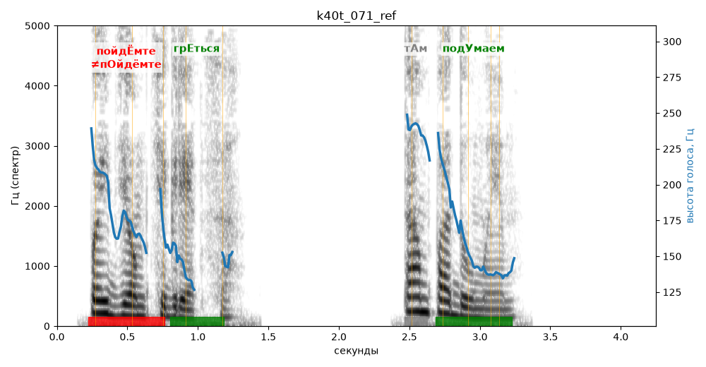

# k40t_071_ref

Голос: **edge:ru-RU-SvetlanaNeural** · длительность 4.2 с
Эталон: Пойдёмте греться. Там подумаем.
Распознано: Пойдем тягреться. Там подумаем.
Расхождения в словах: «пойдемте греться» → «пойдем тягреться»

## Ударения
(где нужно: ruaccent)

| слово | нужно | у голоса | |
|---|---|---|---|
| пойдёмте | пойдЁмте | пОйдёмте | ✗ ОШИБКА |
| греться | грЕться | грЕться | ✓ |
| подумаем | подУмаем | подУмаем | ✓ |

## Интонация
- ✓ «пойдёмте греться.» — конец фразы понижается — звучит законченно
- ✗ «там подумаем.» — конец фразы не понижается — звучит незаконченно / как перечисление
- Диапазон голоса 9.8 полутонов (живо), средняя высота 163 Гц

## Паузы и темп
- паузы на своих местах
- Темп 5.8 слога/с (нормально)

_Синяя линия — высота голоса. Над словами заглавная буква — где ударение должно быть; красным — голос поставил не туда (уверенно), оранжевым — возможно._
