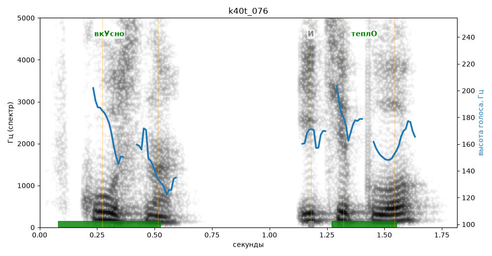

# k40t_076

Эталон: Вкусно. И тепло.
Распознано: вкусно и тепло.
Слова: все совпали

## Ударения
(где нужно: ruaccent)

| слово | нужно | у голоса | |
|---|---|---|---|
| вкусно | вкУсно | вкУсно | ✓ |
| тепло | теплО | теплО | ✓ |

## Интонация
- ✓ «и тепло.» — конец фразы понижается — звучит законченно
- Диапазон голоса 6.6 полутонов (нормально), средняя высота 162 Гц

## Паузы и темп
- паузы на своих местах
- Темп 6.0 слога/с (нормально)

_Синяя линия — высота голоса. Над словами заглавная буква — где ударение должно быть; красным — голос поставил не туда (уверенно), оранжевым — возможно._
