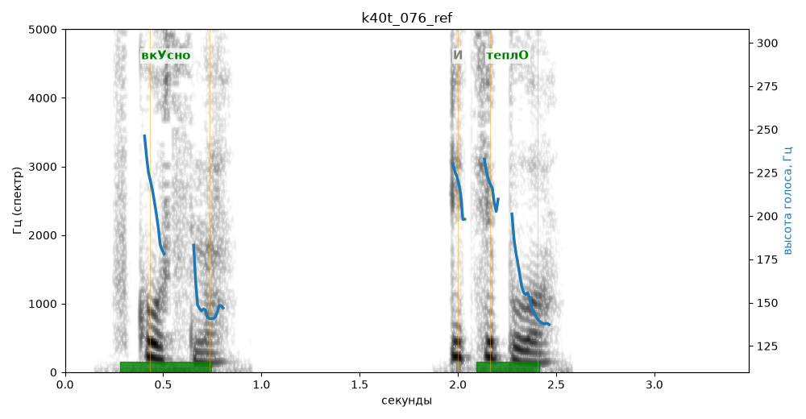

# k40t_076_ref

Голос: **edge:ru-RU-SvetlanaNeural** · длительность 3.5 с
Эталон: Вкусно. И тепло.
Распознано: вкусно и тепло
Слова: все совпали

## Ударения
(где нужно: ruaccent)

| слово | нужно | у голоса | |
|---|---|---|---|
| вкусно | вкУсно | вкУсно | ✓ |
| тепло | теплО | теплО | ✓ |

## Интонация
- ✓ «и тепло.» — конец фразы понижается — звучит законченно
- Диапазон голоса 8.8 полутонов (живо), средняя высота 169 Гц

## Паузы и темп
- паузы на своих местах
- Темп 5.6 слога/с (нормально)

_Синяя линия — высота голоса. Над словами заглавная буква — где ударение должно быть; красным — голос поставил не туда (уверенно), оранжевым — возможно._
