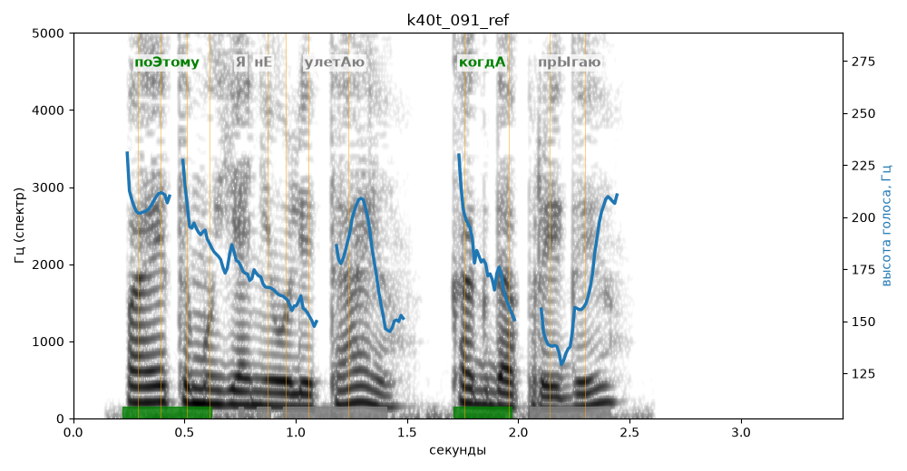

# k40t_091_ref

Голос: **edge:ru-RU-SvetlanaNeural** · длительность 3.5 с
Эталон: Поэтому я не улетаю, когда прыгаю?
Распознано: Поэтому я не улетаю, когда прыгаю.
Слова: все совпали

## Ударения
(где нужно: ruaccent)

| слово | нужно | у голоса | |
|---|---|---|---|
| поэтому | поЭтому | поЭтому | ✓ |
| улетаю | улетАю | — | ? |
| когда | когдА | когдА | ✓ |
| прыгаю | прЫгаю | — | ? |

## Интонация
- ✗ «поэтому я не улетаю когда прыгаю?» — нет вопросительного подъёма (самое высокое место — «поэтому», в начале) — звучит как утверждение
- Диапазон голоса 7.3 полутонов (живо), средняя высота 176 Гц

## Паузы и темп
- паузы на своих местах
- Темп 6.4 слога/с (нормально)

_Синяя линия — высота голоса. Над словами заглавная буква — где ударение должно быть; красным — голос поставил не туда (уверенно), оранжевым — возможно._
