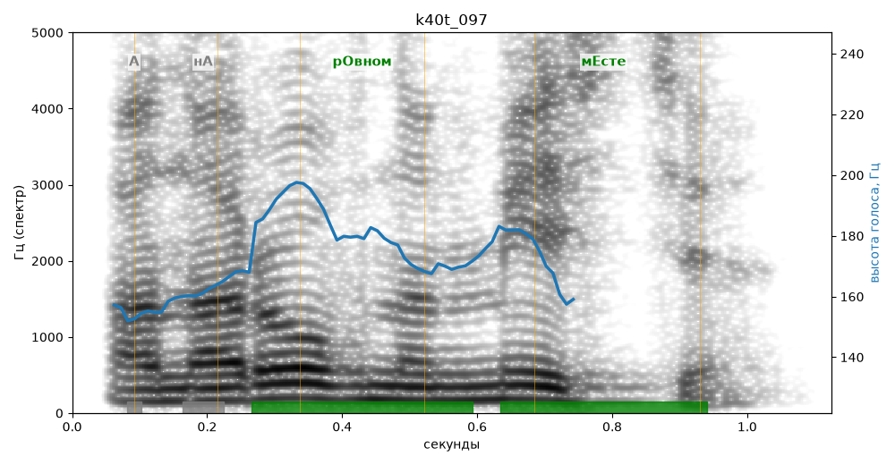

# k40t_097

Эталон: А на ровном месте?
Распознано: Анаровном месте.
Расхождения в словах: «а на ровном» → «анаровном»

## Ударения
(где нужно: ruaccent)

| слово | нужно | у голоса | |
|---|---|---|---|
| ровном | рОвном | рОвном | ✓ |
| месте | мЕсте | мЕсте | ✓ |

## Интонация
- ✗ «а на ровном месте?» — нет вопросительного подъёма (самое высокое место — «ровном», в начале) — звучит как утверждение
- Диапазон голоса 4.0 полутонов (монотонно, как робот), средняя высота 171 Гц

## Паузы и темп
- паузы на своих местах
- Темп 7.0 слога/с (быстро)

_Синяя линия — высота голоса. Над словами заглавная буква — где ударение должно быть; красным — голос поставил не туда (уверенно), оранжевым — возможно._
