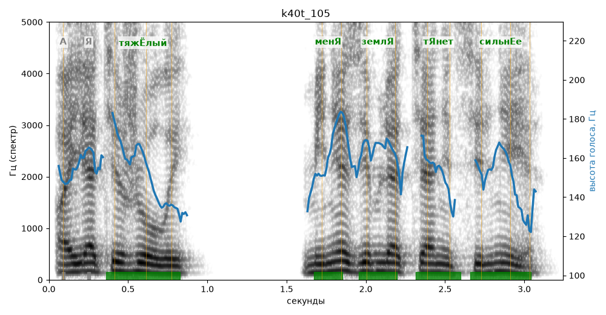

# k40t_105

Эталон: А я тяжёлый. Меня Земля тянет сильнее?
Распознано: А я тяжелый. Меня земля тянет сильнее.
Слова: все совпали

## Ударения
(где нужно: ruaccent)

| слово | нужно | у голоса | |
|---|---|---|---|
| тяжёлый | тяжЁлый | тяжЁлый | ✓ |
| меня | менЯ | менЯ | ✓ |
| земля | землЯ | землЯ | ✓ |
| тянет | тЯнет | тЯнет | ✓ |
| сильнее | сильнЕе | сильнЕе | ✓ |

## Интонация
- ✗ «а я тяжёлый.» — конец фразы не понижается — звучит незаконченно / как перечисление
- ✗ «меня земля тянет сильнее?» — нет вопросительного подъёма (самое высокое место — «меня», в начале) — звучит как утверждение
- Диапазон голоса 4.9 полутонов (нормально), средняя высота 156 Гц

## Паузы и темп
- паузы на своих местах
- Темп 6.1 слога/с (нормально)

_Синяя линия — высота голоса. Над словами заглавная буква — где ударение должно быть; красным — голос поставил не туда (уверенно), оранжевым — возможно._
