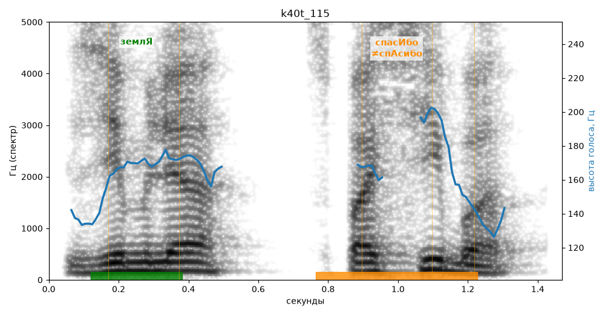

# k40t_115

Эталон: Земля, спасибо!
Распознано: Земля, спасибо!
Слова: все совпали

## Ударения
(где нужно: ruaccent)

| слово | нужно | у голоса | |
|---|---|---|---|
| земля | землЯ | землЯ | ✓ |
| спасибо | спасИбо | спАсибо | ✗? возможно — послушать |

## Интонация
- ✓ «земля спасибо!» — выделено слово «спасибо» (+2.7 пт)
- Диапазон голоса 6.9 полутонов (нормально), средняя высота 167 Гц

## Паузы и темп
- паузы на своих местах
- Темп 6.9 слога/с (быстро)

_Синяя линия — высота голоса. Над словами заглавная буква — где ударение должно быть; красным — голос поставил не туда (уверенно), оранжевым — возможно._
