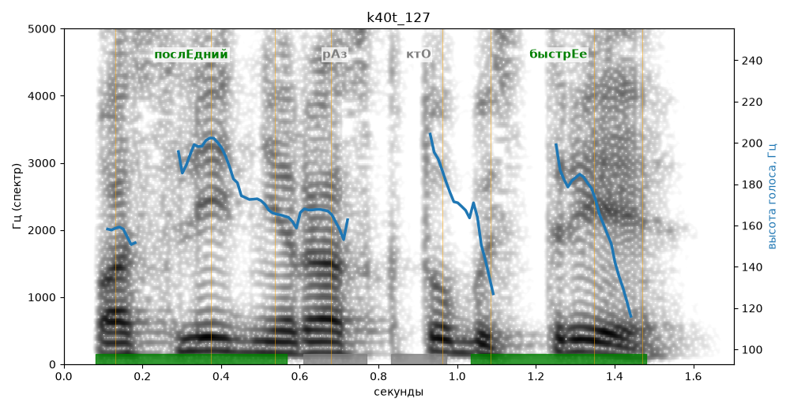

# k40t_127

Эталон: Последний раз! Кто быстрее?
Распознано: Последний раз кто быстрее?
Слова: все совпали

## Ударения
(где нужно: ruaccent)

| слово | нужно | у голоса | |
|---|---|---|---|
| последний | послЕдний | послЕдний | ✓ |
| быстрее | быстрЕе | быстрЕе | ✓ |

## Интонация
- ✓ «последний раз!» — выделено слово «последний» (+2.8 пт)
- ✗ «кто быстрее?» — конец фразы не понижается — звучит незаконченно / как перечисление
- Диапазон голоса 6.7 полутонов (нормально), средняя высота 168 Гц

## Паузы и темп
- после «раз!» пауза всего 0.06 с — фразы слипаются
- Темп 5.7 слога/с (нормально)

_Синяя линия — высота голоса. Над словами заглавная буква — где ударение должно быть; красным — голос поставил не туда (уверенно), оранжевым — возможно._
