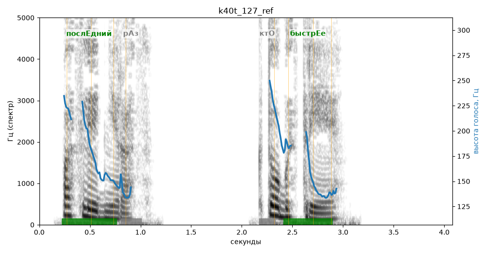

# k40t_127_ref

Голос: **edge:ru-RU-SvetlanaNeural** · длительность 4.1 с
Эталон: Последний раз! Кто быстрее?
Распознано: Последний раз. Кто быстрее?
Слова: все совпали

## Ударения
(где нужно: ruaccent)

| слово | нужно | у голоса | |
|---|---|---|---|
| последний | послЕдний | послЕдний | ✓ |
| быстрее | быстрЕе | быстрЕе | ✓ |

## Интонация
- ✗ «последний раз!» — восклицание звучит ровно, без эмоции
- ✓ «кто быстрее?» — конец фразы понижается — звучит законченно
- Диапазон голоса 9.2 полутонов (живо), средняя высота 157 Гц

## Паузы и темп
- паузы на своих местах
- Темп 5.3 слога/с (нормально)

_Синяя линия — высота голоса. Над словами заглавная буква — где ударение должно быть; красным — голос поставил не туда (уверенно), оранжевым — возможно._
