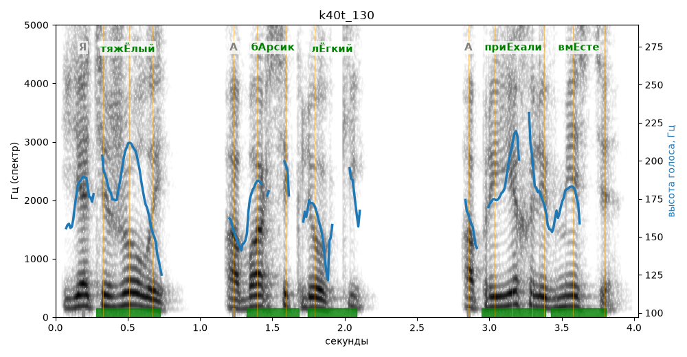

# k40t_130

Эталон: Я тяжёлый, а Барсик лёгкий. А приехали вместе!
Распознано: Я тяжелый, обар сиклевки, а приехали вместе.
Расхождения в словах: «а барсик легкий» → «обар сиклевки»

## Ударения
(где нужно: ruaccent)

| слово | нужно | у голоса | |
|---|---|---|---|
| тяжёлый | тяжЁлый | тяжЁлый | ✓ |
| барсик | бАрсик | бАрсик | ✓ |
| лёгкий | лЁгкий | лЁгкий | ✓ |
| приехали | приЕхали | приЕхали | ✓ |
| вместе | вмЕсте | вмЕсте | ✓ |

## Интонация
- ✓ «я тяжёлый а барсик лёгкий.» — конец фразы понижается — звучит законченно
- ✓ «а приехали вместе!» — выделено слово «приехали» (+2.5 пт)
- Диапазон голоса 6.5 полутонов (нормально), средняя высота 175 Гц

## Паузы и темп
- паузы на своих местах
- Темп 6.3 слога/с (нормально)

_Синяя линия — высота голоса. Над словами заглавная буква — где ударение должно быть; красным — голос поставил не туда (уверенно), оранжевым — возможно._
