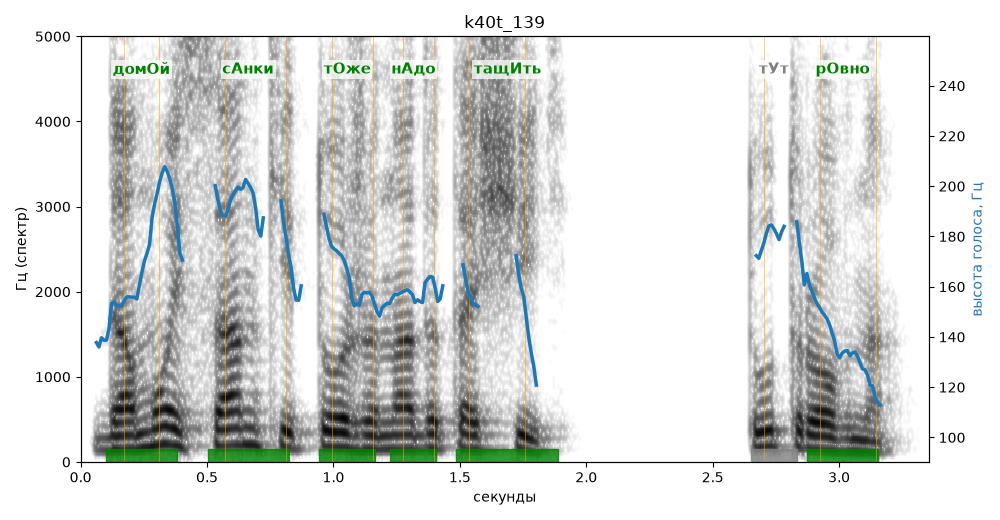

# k40t_139

Эталон: Домой санки тоже надо тащить. Тут ровно.
Распознано: Домой санки тоже надо точить. Тут ровно.
Расхождения в словах: «тащить» → «точить»

## Ударения
(где нужно: ruaccent)

| слово | нужно | у голоса | |
|---|---|---|---|
| домой | домОй | домОй | ✓ |
| санки | сАнки | сАнки | ✓ |
| тоже | тОже | тОже | ✓ |
| надо | нАдо | нАдо | ✓ |
| тащить | тащИть | тащИть | ✓ |
| ровно | рОвно | рОвно | ✓ |

## Интонация
- ✓ «домой санки тоже надо тащить.» — конец фразы понижается — звучит законченно
- ✗ «тут ровно.» — конец фразы не понижается — звучит незаконченно / как перечисление
- Диапазон голоса 7.7 полутонов (живо), средняя высота 158 Гц

## Паузы и темп
- паузы на своих местах
- Темп 5.7 слога/с (нормально)

_Синяя линия — высота голоса. Над словами заглавная буква — где ударение должно быть; красным — голос поставил не туда (уверенно), оранжевым — возможно._
