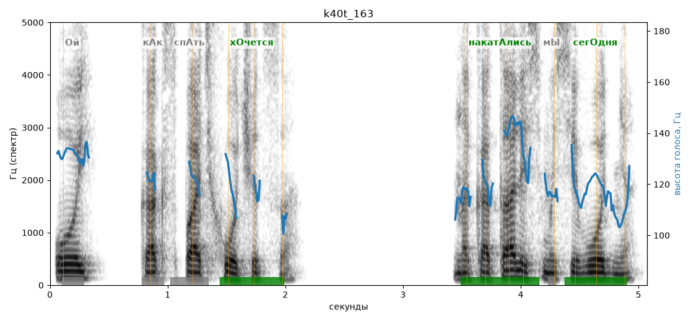

# k40t_163

Эталон: Ой, как спать хочется. Накатались мы сегодня!
Распознано: Ой, как спать хочется. Накатались мы сегодня.
Слова: все совпали

## Ударения
(где нужно: ruaccent)

| слово | нужно | у голоса | |
|---|---|---|---|
| хочется | хОчется | хОчется | ✓ |
| накатались | накатАлись | накатАлись | ✓ |
| сегодня | сегОдня | сегОдня | ✓ |

## Интонация
- ✗ «ой как спать хочется.» — конец фразы не понижается — звучит незаконченно / как перечисление
- ✓ «накатались мы сегодня!» — выделено слово «накатались» (+3.3 пт)
- Диапазон голоса 5.1 полутонов (нормально), средняя высота 121 Гц

## Паузы и темп
- паузы на своих местах
- Темп 5.0 слога/с (нормально)

_Синяя линия — высота голоса. Над словами заглавная буква — где ударение должно быть; красным — голос поставил не туда (уверенно), оранжевым — возможно._
