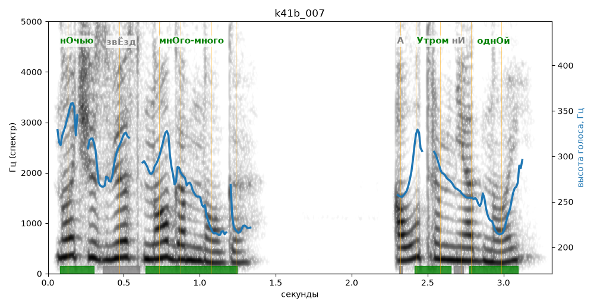

# k41b_007

Эталон: Ночью звёзд много-много. А утром ни одной.
Распознано: Ночью звезд много-много. А утром не одной.
Расхождения в словах: «ни» → «не»

## Ударения
(где нужно: ruaccent)

| слово | нужно | у голоса | |
|---|---|---|---|
| ночью | нОчью | нОчью | ✓ |
| много-много | мнОго-много | мнОго-много | ✓ |
| утром | Утром | Утром | ✓ |
| одной | однОй | однОй | ✓ |

## Интонация
- ✗ «ночью звёзд много-много.» — конец фразы не понижается — звучит незаконченно / как перечисление
- ✓ «а утром ни одной.» — конец фразы понижается — звучит законченно
- Диапазон голоса 7.3 полутонов (живо), средняя высота 269 Гц

## Паузы и темп
- паузы на своих местах
- Темп 6.2 слога/с (нормально)

_Синяя линия — высота голоса. Над словами заглавная буква — где ударение должно быть; красным — голос поставил не туда (уверенно), оранжевым — возможно._
