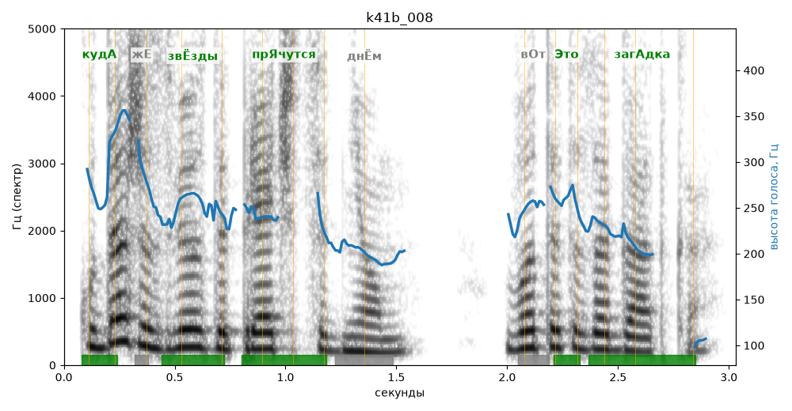

# k41b_008

Эталон: Куда же звёзды прячутся днём? Вот это загадка!
Распознано: Куда же звёзды прячутся днём? Вот эта загадка.
Расхождения в словах: «это» → «эта»

## Ударения
(где нужно: ruaccent)

| слово | нужно | у голоса | |
|---|---|---|---|
| куда | кудА | кудА | ✓ |
| звёзды | звЁзды | звЁзды | ✓ |
| прячутся | прЯчутся | прЯчутся | ✓ |
| это | Это | Это | ✓ |
| загадка | загАдка | загАдка | ✓ |

## Интонация
- ✓ «куда же звёзды прячутся днём?» — конец фразы понижается — звучит законченно
- ✗ «вот это загадка!» — восклицание звучит ровно, без эмоции
- Диапазон голоса 9.2 полутонов (живо), средняя высота 239 Гц

## Паузы и темп
- паузы на своих местах
- Темп 6.8 слога/с (быстро)

_Синяя линия — высота голоса. Над словами заглавная буква — где ударение должно быть; красным — голос поставил не туда (уверенно), оранжевым — возможно._
