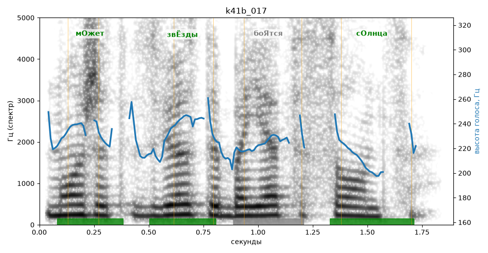

# k41b_017

Эталон: Может, звёзды боятся солнца?
Распознано: Может звезды боятся солнца?
Слова: все совпали

## Ударения
(где нужно: ruaccent)

| слово | нужно | у голоса | |
|---|---|---|---|
| может | мОжет | мОжет | ✓ |
| звёзды | звЁзды | звЁзды | ✓ |
| боятся | боЯтся | — | ? |
| солнца | сОлнца | сОлнца | ✓ |

## Интонация
- ✗ «может звёзды боятся солнца?» — нет вопросительного подъёма (самое высокое место — «звёзды», в начале) — звучит как утверждение
- Диапазон голоса 3.4 полутонов (монотонно, как робот), средняя высота 225 Гц

## Паузы и темп
- паузы на своих местах
- Темп 4.9 слога/с (нормально)

_Синяя линия — высота голоса. Над словами заглавная буква — где ударение должно быть; красным — голос поставил не туда (уверенно), оранжевым — возможно._
