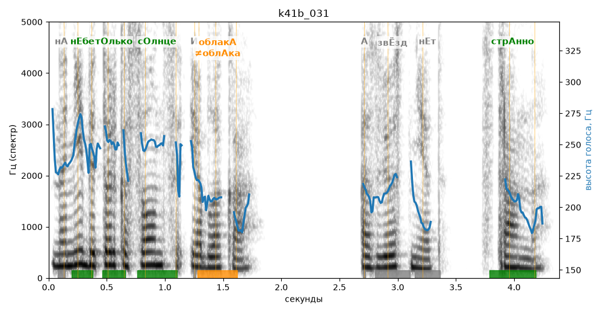

# k41b_031

Эталон: На небе только солнце и облака. А звёзд нет. Странно!
Распознано: На небе только солнце и облака. А звёзд нет. Странно.
Слова: все совпали

## Ударения
(где нужно: ruaccent)

| слово | нужно | у голоса | |
|---|---|---|---|
| небе | нЕбе | нЕбе | ✓ |
| только | тОлько | тОлько | ✓ |
| солнце | сОлнце | сОлнце | ✓ |
| облака | облакА | облАка | ✗? возможно — послушать |
| странно | стрАнно | стрАнно | ✓ |

## Интонация
- ✓ «на небе только солнце и облака.» — конец фразы понижается — звучит законченно
- ✓ «а звёзд нет.» — конец фразы понижается — звучит законченно
- Диапазон голоса 6.0 полутонов (нормально), средняя высота 217 Гц

## Паузы и темп
- паузы на своих местах
- Темп 6.1 слога/с (нормально)

_Синяя линия — высота голоса. Над словами заглавная буква — где ударение должно быть; красным — голос поставил не туда (уверенно), оранжевым — возможно._
