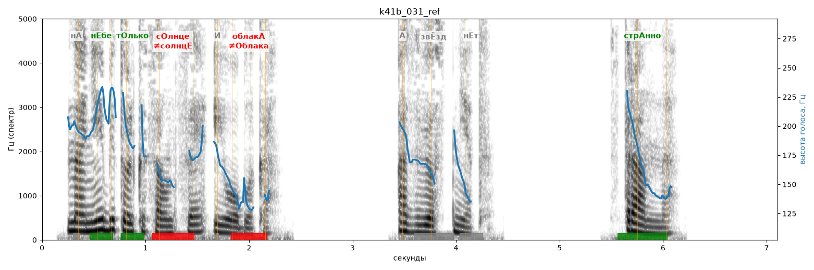

# k41b_031_ref

Голос: **edge:ru-RU-SvetlanaNeural** · длительность 7.1 с
Эталон: На небе только с+олнце и облака. А звёзд нет. Странно!
Распознано: На небе только солнце и облака. А звёзд нет. Странно.
Слова: все совпали

## Ударения
(где нужно: ruaccent)

| слово | нужно | у голоса | |
|---|---|---|---|
| небе | нЕбе | нЕбе | ✓ |
| только | тОлько | тОлько | ✓ |
| солнце | сОлнце | солнцЕ | ✗ ОШИБКА |
| облака | облакА | Облака | ✗ ОШИБКА |
| странно | стрАнно | стрАнно | ✓ |

## Интонация
- ✓ «на небе только солнце и облака.» — конец фразы понижается — звучит законченно
- ✓ «а звёзд нет.» — конец фразы понижается — звучит законченно
- Диапазон голоса 8.6 полутонов (живо), средняя высота 169 Гц

## Паузы и темп
- паузы на своих местах
- Темп 5.5 слога/с (нормально)

_Синяя линия — высота голоса. Над словами заглавная буква — где ударение должно быть; красным — голос поставил не туда (уверенно), оранжевым — возможно._
