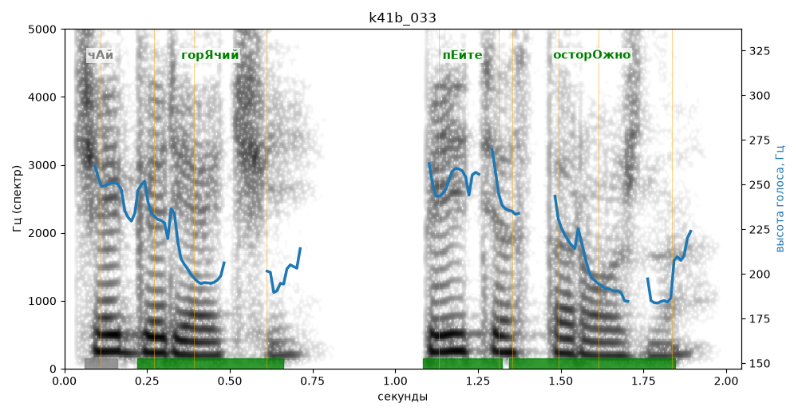

# k41b_033

Эталон: Чай горячий. Пейте осторожно.
Распознано: Чего рячий? Пейте осторожно!
Расхождения в словах: «чай горячий» → «чего рячий»

## Ударения
(где нужно: ruaccent)

| слово | нужно | у голоса | |
|---|---|---|---|
| горячий | горЯчий | горЯчий | ✓ |
| пейте | пЕйте | пЕйте | ✓ |
| осторожно | осторОжно | осторОжно | ✓ |

## Интонация
- ✓ «чай горячий.» — конец фразы понижается — звучит законченно
- ✓ «пейте осторожно.» — конец фразы понижается — звучит законченно
- Диапазон голоса 5.7 полутонов (нормально), средняя высота 220 Гц

## Паузы и темп
- паузы на своих местах
- Темп 7.3 слога/с (быстро)

_Синяя линия — высота голоса. Над словами заглавная буква — где ударение должно быть; красным — голос поставил не туда (уверенно), оранжевым — возможно._
