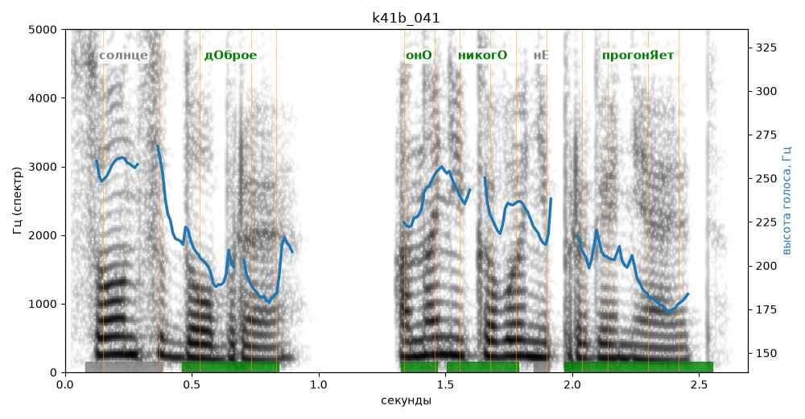

# k41b_041

Эталон: Солнце доброе. Оно никого не прогоняет.
Распознано: Солнце добре, она никого не прогоняет.
Расхождения в словах: «доброе оно» → «добре она»

## Ударения
(где нужно: ruaccent)

| слово | нужно | у голоса | |
|---|---|---|---|
| солнце | солнце | сОлнце | нет эталона |
| доброе | дОброе | дОброе | ✓ |
| оно | онО | онО | ✓ |
| никого | никогО | никогО | ✓ |
| прогоняет | прогонЯет | прогонЯет | ✓ |

## Интонация
- ✗ «солнце доброе.» — конец фразы не понижается — звучит незаконченно / как перечисление
- ✓ «оно никого не прогоняет.» — конец фразы понижается — звучит законченно
- Диапазон голоса 6.4 полутонов (нормально), средняя высота 215 Гц

## Паузы и темп
- паузы на своих местах
- Темп 7.5 слога/с (быстро)

_Синяя линия — высота голоса. Над словами заглавная буква — где ударение должно быть; красным — голос поставил не туда (уверенно), оранжевым — возможно._
