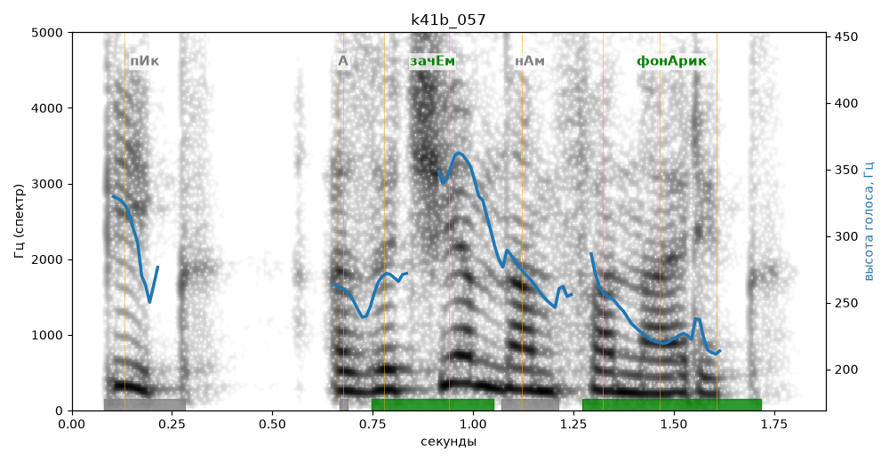

# k41b_057

Эталон: Пик, а зачем нам фонарик?
Распознано: Пик, а зачем нам фонарик?
Слова: все совпали

## Ударения
(где нужно: ruaccent)

| слово | нужно | у голоса | |
|---|---|---|---|
| зачем | зачЕм | зачЕм | ✓ |
| фонарик | фонАрик | фонАрик | ✓ |

## Интонация
- ✗ «пик а зачем нам фонарик?» — нет вопросительного подъёма (самое высокое место — «зачем», в начале) — звучит как утверждение
- Диапазон голоса 8.1 полутонов (живо), средняя высота 262 Гц

## Паузы и темп
- паузы на своих местах
- Темп 6.4 слога/с (нормально)

_Синяя линия — высота голоса. Над словами заглавная буква — где ударение должно быть; красным — голос поставил не туда (уверенно), оранжевым — возможно._
