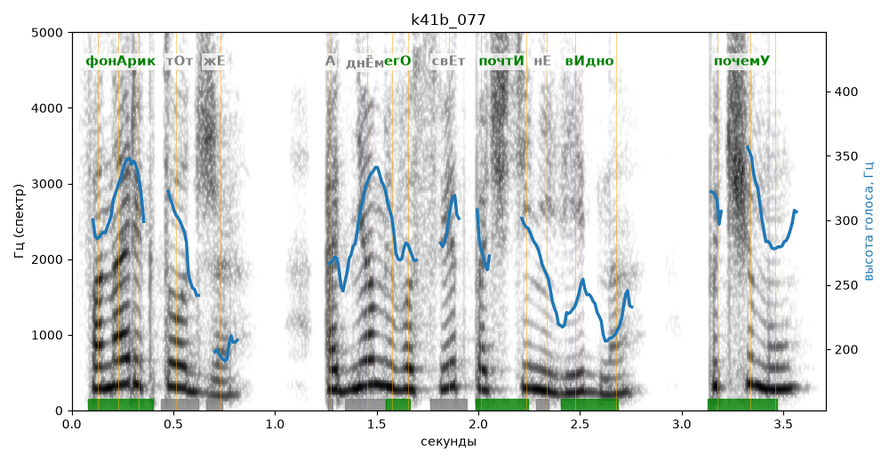

# k41b_077

Эталон: Фонарик тот же. А днём его свет почти не видно. Почему?
Распознано: Фанарик тот же. Однём его свет почти невидно. Почему?
Расхождения в словах: «фонарик» → «фанарик»; «а днем» → «однем»; «не видно» → «невидно»

## Ударения
(где нужно: ruaccent)

| слово | нужно | у голоса | |
|---|---|---|---|
| фонарик | фонАрик | фонАрик | ✓ |
| его | егО | егО | ✓ |
| почти | почтИ | почтИ | ✓ |
| видно | вИдно | вИдно | ✓ |
| почему | почемУ | почемУ | ✓ |

## Интонация
- ✓ «фонарик тот же.» — конец фразы понижается — звучит законченно
- ✓ «а днём его свет почти не видно.» — конец фразы понижается — звучит законченно
- ✓ «почему?» — конец фразы понижается — звучит законченно
- Диапазон голоса 8.7 полутонов (живо), средняя высота 281 Гц

## Паузы и темп
- паузы на своих местах
- Темп 7.4 слога/с (быстро)

_Синяя линия — высота голоса. Над словами заглавная буква — где ударение должно быть; красным — голос поставил не туда (уверенно), оранжевым — возможно._
