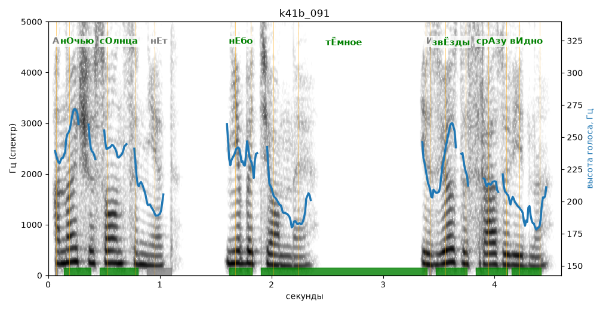

# k41b_091

Эталон: А ночью солнца нет. Небо тёмное. И звёзды сразу видно!
Распознано: Оно и час он ценят, неботемные. Извезда сразу видно.
Расхождения в словах: «а ночью солнца нет небо темное» → «оно»; «звезды» → «час он ценят неботемные извезда»

## Ударения
(где нужно: ruaccent)

| слово | нужно | у голоса | |
|---|---|---|---|
| ночью | нОчью | нОчью | ✓ |
| солнца | сОлнца | сОлнца | ✓ |
| небо | нЕбо | нЕбо | ✓ |
| тёмное | тЁмное | тЁмное | ✓ |
| звёзды | звЁзды | звЁзды | ✓ |
| сразу | срАзу | срАзу | ✓ |
| видно | вИдно | вИдно | ✓ |

## Интонация
- ✓ «а ночью солнца нет.» — конец фразы понижается — звучит законченно
- ✓ «небо тёмное.» — конец фразы понижается — звучит законченно
- ✓ «и звёзды сразу видно!» — выделено слово «звёзды» (+2.8 пт)
- Диапазон голоса 6.0 полутонов (нормально), средняя высота 214 Гц

## Паузы и темп
- после «тёмное.» пауза всего 0.02 с — фразы слипаются
- Темп 4.4 слога/с (нормально)

_Синяя линия — высота голоса. Над словами заглавная буква — где ударение должно быть; красным — голос поставил не туда (уверенно), оранжевым — возможно._
