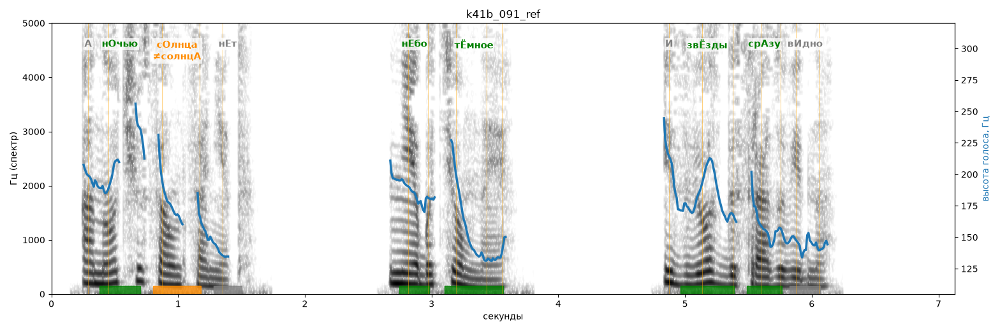

# k41b_091_ref

Голос: **edge:ru-RU-SvetlanaNeural** · длительность 7.1 с
Эталон: А ночью с+олнца нет. Небо тёмное. И звёзды сразу в+идно!
Распознано: Оно чесалнца нет. Не оботемные. Извезда сразу видно.
Расхождения в словах: «а ночью солнца» → «оно чесалнца»; «небо темное и звезды» → «не оботемные извезда»

## Ударения
(где нужно: ruaccent)

| слово | нужно | у голоса | |
|---|---|---|---|
| ночью | нОчью | нОчью | ✓ |
| солнца | сОлнца | солнцА | ✗? возможно — послушать |
| небо | нЕбо | нЕбо | ✓ |
| тёмное | тЁмное | тЁмное | ✓ |
| звёзды | звЁзды | звЁзды | ✓ |
| сразу | срАзу | срАзу | ✓ |
| видно | вИдно | виднО | ? не разобрать |

## Интонация
- ✓ «а ночью солнца нет.» — конец фразы понижается — звучит законченно
- ✗ «небо тёмное.» — конец фразы не понижается — звучит незаконченно / как перечисление
- ✓ «и звёзды сразу видно!» — выделено слово «звёзды» (+3.1 пт)
- Диапазон голоса 8.2 полутонов (живо), средняя высота 171 Гц

## Паузы и темп
- паузы на своих местах
- Темп 5.2 слога/с (нормально)

_Синяя линия — высота голоса. Над словами заглавная буква — где ударение должно быть; красным — голос поставил не туда (уверенно), оранжевым — возможно._
