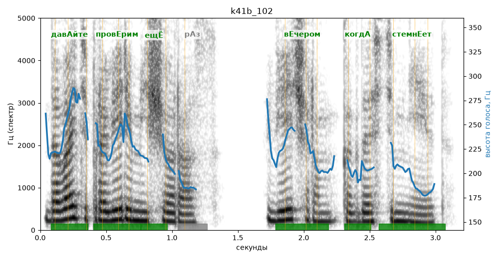

# k41b_102

Эталон: Давайте проверим ещё раз. Вечером, когда стемнеет.
Распознано: Давайте проверим еще раз, вечером, когда стемнеет.
Слова: все совпали

## Ударения
(где нужно: ruaccent)

| слово | нужно | у голоса | |
|---|---|---|---|
| давайте | давАйте | давАйте | ✓ |
| проверим | провЕрим | провЕрим | ✓ |
| ещё | ещЁ | ещЁ | ✓ |
| вечером | вЕчером | вЕчером | ✓ |
| когда | когдА | когдА | ✓ |
| стемнеет | стемнЕет | стемнЕет | ✓ |

## Интонация
- ✓ «давайте проверим ещё раз.» — конец фразы понижается — звучит законченно
- ✓ «вечером когда стемнеет.» — конец фразы понижается — звучит законченно
- Диапазон голоса 6.4 полутонов (нормально), средняя высота 215 Гц

## Паузы и темп
- паузы на своих местах
- Темп 6.9 слога/с (быстро)

_Синяя линия — высота голоса. Над словами заглавная буква — где ударение должно быть; красным — голос поставил не туда (уверенно), оранжевым — возможно._
