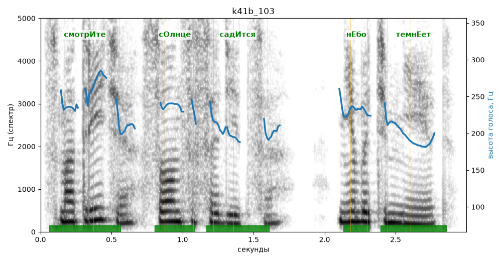

# k41b_103

Эталон: Смотрите, солнце садится. Небо темнеет.
Распознано: Смотрите, солнце садится. Не быть умеет.
Расхождения в словах: «небо темнеет» → «не быть умеет»

## Ударения
(где нужно: ruaccent)

| слово | нужно | у голоса | |
|---|---|---|---|
| смотрите | смотрИте | смотрИте | ✓ |
| солнце | сОлнце | сОлнце | ✓ |
| садится | садИтся | садИтся | ✓ |
| небо | нЕбо | нЕбо | ✓ |
| темнеет | темнЕет | темнЕет | ✓ |

## Интонация
- ✓ «смотрите солнце садится.» — конец фразы понижается — звучит законченно
- ✓ «небо темнеет.» — конец фразы понижается — звучит законченно
- Диапазон голоса 6.7 полутонов (нормально), средняя высота 218 Гц

## Паузы и темп
- паузы на своих местах
- Темп 6.4 слога/с (нормально)

_Синяя линия — высота голоса. Над словами заглавная буква — где ударение должно быть; красным — голос поставил не туда (уверенно), оранжевым — возможно._
