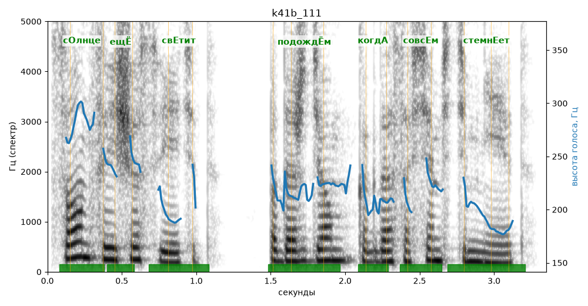

# k41b_111

Эталон: Солнце ещё светит. Подождём, когда совсем стемнеет.
Распознано: Солнце еще светит. Подождем, когда совсем стемнеет.
Слова: все совпали

## Ударения
(где нужно: ruaccent)

| слово | нужно | у голоса | |
|---|---|---|---|
| солнце | сОлнце | сОлнце | ✓ |
| ещё | ещЁ | ещЁ | ✓ |
| светит | свЕтит | свЕтит | ✓ |
| подождём | подождЁм | подождЁм | ✓ |
| когда | когдА | когдА | ✓ |
| совсем | совсЕм | совсЕм | ✓ |
| стемнеет | стемнЕет | стемнЕет | ✓ |

## Интонация
- ✓ «солнце ещё светит.» — конец фразы понижается — звучит законченно
- ✓ «подождём когда совсем стемнеет.» — конец фразы понижается — звучит законченно
- Диапазон голоса 7.8 полутонов (живо), средняя высота 216 Гц

## Паузы и темп
- паузы на своих местах
- Темп 5.9 слога/с (нормально)

_Синяя линия — высота голоса. Над словами заглавная буква — где ударение должно быть; красным — голос поставил не туда (уверенно), оранжевым — возможно._
