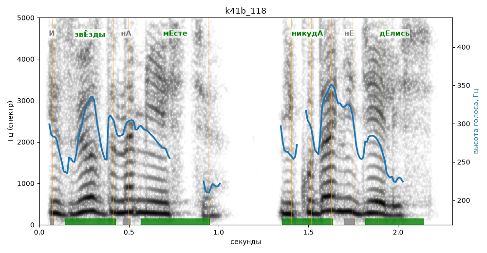

# k41b_118

Эталон: И звёзды на месте! Никуда не делись!
Распознано: Извезда на месте. Никуда не делись.
Расхождения в словах: «и звезды» → «извезда»

## Ударения
(где нужно: ruaccent)

| слово | нужно | у голоса | |
|---|---|---|---|
| звёзды | звЁзды | звЁзды | ✓ |
| месте | мЕсте | мЕсте | ✓ |
| никуда | никудА | никудА | ✓ |
| делись | дЕлись | дЕлись | ✓ |

## Интонация
- ✗ «и звёзды на месте!» — восклицание звучит ровно, без эмоции
- ✓ «никуда не делись!» — выделено слово «никуда» (+3.1 пт)
- Диапазон голоса 7.1 полутонов (живо), средняя высота 282 Гц

## Паузы и темп
- паузы на своих местах
- Темп 7.2 слога/с (быстро)

_Синяя линия — высота голоса. Над словами заглавная буква — где ударение должно быть; красным — голос поставил не туда (уверенно), оранжевым — возможно._
